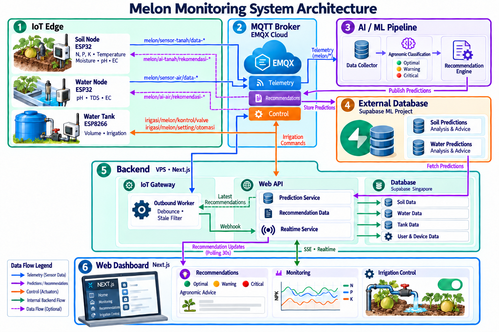

# Soil and Water Monitoring and Faucet Control System

A web-based, multi-device monitoring and control platform for ESP32/NodeMCU hardware in agricultural environments.

The platform provides end-to-end telemetry ingestion, external ML agronomic recommendation integration, water reservoir tracking, role-based user management, audited lifecycle administration, multilingual support, and safety-interlocked physical irrigation valve control.

---

## 1. Project Overview

Kebun Melon is designed to manage agricultural sensor networks and irrigation infrastructure across three distinct monitoring and control domains, consolidated onto a unified cloud MQTT broker architecture (`DEC-DEV-035`):

1. **Soil Quality Monitoring (MQTT 5.0 over TLS via Primary EMQX Cloud Broker):**
   - Ingests Nitrogen (N), Phosphorus (P), Potassium (K), Soil Temperature (°C), Moisture (%), pH, Electrical Conductivity (EC canonically standardized in `µS/cm` per `DEC-MON-091`), and Soil Status.
   - Sensor Battery (`BAT`) parameter is completely removed per `DEC-MON-086`.
   - Ingested via primary EMQX Cloud broker on topic `melon/sensor-tanah/data-2424600050` with outbound agronomic recommendations published to `melon/ai-tanah/rekomendasi-2424600050` (HiveMQ fallback permanently retired per `TASK-0416` / `DEC-DEV-035`).
   - 90-day retention TTL with chunked batch maintenance (`DEC-MON-048` / `TASK-0913`).

2. **Water Quality Monitoring (MQTT 5.0 over TLS via Primary EMQX Cloud Broker):**
   - Ingests pH, Total Dissolved Solids (TDS in `ppm`), Electrical Conductivity (EC canonically standardized in `µS/cm` per `DEC-MON-091`), and Water Status.
   - Battery, Latitude, and Longitude parameters are completely removed per `DEC-MON-086`. Temperature is omitted from water quality history tables per `DEC-MON-094`.
   - Ingested via primary EMQX Cloud broker on topic `melon/sensor-air/data-2424600050` with outbound agronomic recommendations published to `melon/ai-air/rekomendasi-2424600050` (HiveMQ fallback permanently retired per `TASK-0416` / `DEC-DEV-035`).
   - 90-day retention TTL with chunked batch maintenance (`DEC-MON-048` / `TASK-0913`).

3. **Reservoir Water Tank Monitoring (MQTT 5.0 over TLS via Primary EMQX Cloud Broker):**
   - Ingests Tank Water Volume (0 L–2,200 L operational scale, authoritative maximum capacity constant `WATER_TANK_MAX_CAPACITY = 2200` per `DEC-MON-089`) and Reservoir Status. Flow rate parameter is permanently deleted per `DEC-MON-089`.
   - Strict per-device latest-5 records retention policy (`DEC-MON-092` / `TASK-0917`).
   - Uses dedicated MQTT topics:
     - Telemetry Ingestion: `irigasi/melon/sensor/volume`
     - Manual Valve Control: `irigasi/melon/kontrol/valve`
     - Automated Dispensing: `irigasi/melon/setting/otomasi`

4. **External ML Agronomic Recommendations:**
   - Ingests machine learning classifications and agronomic advice from an external team's Supabase project over read-only PostgREST HTTPS (`ExternalPredictionClient`).
   - Mapped dynamically to internal devices via `device_external_mappings`.
   - Hybrid MQTT recommendations published asynchronously via `apps/iot-gateway` without local ML compute (`DEC-MON-090`).
   - Normalized bilingual copy pipeline (`DEC-I18N-096`) and in-app alert evaluation protected by PostgreSQL transaction advisory locks (`DEC-ALRT-101`).

5. **Historical Telemetry Charts & Reading-Sequence Presentation:**
   - **Equidistant Reading-Sequence X-Axis (`DEC-MON-096`, `TASK-0504 Follow-up 4`):** Replaces elapsed-time proportional numeric scaling with an equidistant categorical reading-sequence axis ($x = 0, 1, \dots, n-1$), labeled `"Urutan pembacaan"` (`id`) / `"Reading sequence"` (`en`). Resolves visual clumping for burst telemetry readings (e.g., 65 readings within 11 minutes).
   - **Clean Line Presentation Invariants:** Rendered with straight linear connecting segments (`type="linear"`), completely without circle markers (`dot={false}`), without active hover rings (`activeDot={false}`), and with Recharts `<Brush>` completely removed, restoring compact container heights (`h-44 sm:h-52` for soil, `h-40 sm:h-48` for water).
   - **Exact Tooltips & Overlap Inspection:** Displays full sensor timestamps, exact metric values with units, and discrete truncated `readingId`. Overlapping readings at identical timestamps are grouped and inspectable in tooltips via multi-reading badges.
   - **Server-Side History Pagination:** History tables enforce an independent server-side page size of exactly 5 readings (`HISTORY_PAGE_SIZE = 5`) ordered deterministically by `[{ receivedAt: 'asc' }, { id: 'asc' }]`, completely decoupled from chart range presets (`DEC-MON-094`).

6. **Faucet Control Presets & Safety Invariants:**
   - Preset irrigation phases mapped deterministically on the server:
     - **Phase 1:** 300 mL (UI: 0.3 L)
     - **Phase 2:** 1,000 mL (UI: 1.0 L)
     - **Phase 3:** 1,500 mL (UI: 1.5 L)
   - Server-side safety & authorization: Faucet control is permanently enabled (`ENABLE_FAUCET_CONTROL=true`, `DEC-CTRL-096`) across development, staging, and production. Physical and operational safety is strictly governed by RBAC (`device.control.dispense`), controllable device assignment, online status checks, single-command concurrency locks, 5-minute timeout sweeps (`DEC-CTRL-094`), and comprehensive audit trails.
   - **History & Retention:** Server-side pagination (10 rows/page), terminal status filtering (`COMPLETED`, `TIMEOUT`, `EXPIRED`), and 3-calendar-month retention with anti-replay tombstones rejecting replay attempts with HTTP 409 (`DEC-CTRL-097`, `DEC-CTRL-098`).

7. **User Roles, Authentication & Account Governance:**
   - Exactly two system roles: `OWNER / PIC` (Person in Charge / Penanggung Jawab) and `ADMIN`.
   - Public registration creates only `ADMIN` accounts in `PENDING_APPROVAL` status.
   - **Owner-Exclusive Approval Notifications (`DEC-AUTH-112`):** Real-time toast notifications, sidebar badge counter, and bilingual transactional email via Resend (`sendAdminApprovalRequestEmail`). Active Owners queried strictly by enum code `userRoles: { some: { role: { code: UserRole.OWNER } } }`.
   - **Pending-Admin Rejection Safety (`DEC-AUTH-113`, `TASK-0208`):** Rejection transactionally deletes the pending account while preserving the immutable audit log (`ACCOUNT_REJECTED`) and sending a bilingual rejection email to the applicant.
   - **Approved-Admin Decision Notification (`DEC-AUTH-114`):** Approval dispatches a bilingual notification email with a direct login link derived strictly from authoritative `validateServerEnv().APP_URL`.
   - **Session Lifecycle & Single Active Session (`DEC-AUTH-107`, `TASK-0215`, `TASK-0217`):** Enforces 30-minute idle timeout with physical activity touch, 8-hour absolute session maximum lifetime, multi-tab synchronization via `localStorage`, and single active session per user account rejecting concurrent logins with HTTP 409 Conflict (`ACTIVE_SESSION_EXISTS`).

---

## 2. Core Architecture & Communication Topologies

<p align="center">
  
</p>

### Communication Principles & Boundaries

- **Unified Ingress Broker:** All soil quality, water quality, and reservoir water tank telemetry ingest via EMQX Cloud over TLS on dedicated topic hierarchies. Outbound recommendations and control commands publish through the same broker.
- **Standalone IoT Gateway Service:** Fastify 5 microservice (`apps/iot-gateway`) subscribes to MQTT topics, normalizes hardware envelopes, persists readings to PostgreSQL 17 via Prisma ORM, publishes outbound ML recommendations, and polls for pending faucet commands.
- **No Direct Browser MQTT Connection:** Web browsers never connect directly to the MQTT broker or receive broker credentials. Web clients communicate strictly over HTTPS REST and Server-Sent Events (SSE) via Next.js Web API (`apps/web`).
- **Fail-Closed Security:** All unauthorized requests, missing device assignments, expired sessions, or disabled feature flags fail closed.
- **Idempotent Control:** Faucet commands require client-generated idempotency keys, atomic database reservation, and single-command concurrency per device.

---

## 3. Technology Stack

| Layer                        | Technology                                    | Purpose / Configuration                                                    |
| ---------------------------- | --------------------------------------------- | -------------------------------------------------------------------------- |
| **Monorepo Management**      | npm Workspaces                                | Multi-package repository (`apps/*`, `packages/*`)                          |
| **Web Frontend & API**       | Next.js 14.2+ (App Router), React 19, TS 5    | Server Components, Server-side RBAC, SSR AuthContext hydration             |
| **Styling & UI Components**  | Tailwind CSS, Lucide React, Radix UI          | Clean, accessible dashboard adhering to `Premium Minimal Ops` direction    |
| **Data Visualization**       | Recharts 2.12                                 | Clean line charts with reading-sequence X-axis, zero markers, no Brush     |
| **Form & Schema Validation** | React Hook Form, Zod                          | Runtime validation for forms, API endpoints, and MQTT contracts            |
| **IoT Gateway Service**      | Node.js 20, Fastify 5, TypeScript             | Standalone microservice bridging MQTT broker to PostgreSQL and Web API     |
| **MQTT Client & Broker**     | MQTT.js 5, EMQX Cloud Serverless (Unified)    | TLS/WSS on port 8084 (`wss://<cluster-host>:8084/mqtt`), ACL isolation     |
| **Database & ORM**           | PostgreSQL 17 (Supabase Singapore), Prisma    | Relational persistence, Supavisor connection pooling, transaction locks    |
| **Transactional Email**      | Resend API (`resend`)                         | Verification codes, password resets, approval/rejection notifications      |
| **Internationalisation**     | `next-intl` (bilingual `id` / `en`)           | Cookie-based routing (`id` default, `en` fallback), zero URL pollution     |
| **Testing Framework**        | Vitest 4, Playwright 1.41, v8 Coverage        | Unit, integration, route, component, E2E, and quality gate test suites     |
| **Containerization**         | Docker, Docker Compose, Alpine Linux          | Multi-stage production and staging builds (`apps/web`, `apps/iot-gateway`) |

---

## 4. Repository Structure

```text
kebun-melon/
├── apps/
│   ├── web/                           # Next.js Web Application & REST API
│   │   ├── app/                       # App Router routes, layouts, and API handlers
│   │   │   ├── (auth)/                # Login, register, forgot-password, verify-email
│   │   │   ├── api/v1/                # REST endpoints (/auth, /users, /devices, /monitoring, /controls)
│   │   │   ├── dashboard/             # Aggregated operational Bento monitoring view
│   │   │   ├── soil/                  # Soil quality monitoring, charts & history
│   │   │   ├── water/                 # Water quality monitoring, charts & history
│   │   │   ├── controls/              # Reservoir tank volume & valve control interface
│   │   │   ├── devices/               # Device registry, configuration, status
│   │   │   ├── users/                 # Owner-only user lifecycle administration
│   │   │   ├── approvals/             # Owner-only admin registration approval queue
│   │   │   ├── profile/               # User profile, password change, email update
│   │   │   └── setting/               # Application settings, locale switcher
│   │   ├── components/                # Reusable UI components, charts, and dialogs
│   │   ├── contexts/                  # React Contexts (AuthContext, DeviceContext)
│   │   ├── hooks/                     # Custom hooks (useHistoricalMonitoring, useAlertBadge, etc.)
│   │   ├── lib/                       # Server-side auth, RBAC, session, email utilities
│   │   ├── messages/                  # Localization strings (id.json, en.json)
│   │   └── Dockerfile                 # Standalone multi-stage production Dockerfile
│   │
│   └── iot-gateway/                   # Standalone Fastify IoT Gateway Microservice
│       ├── src/
│       │   ├── app.ts                 # Fastify server composition, hooks, rate limiting
│       │   ├── index.ts               # Server startup, MQTT connection, graceful shutdown
│       │   ├── commands/              # Outbound faucet command polling & dispatching
│       │   ├── config/                # Environment schema and secret redaction
│       │   ├── maintenance/           # Automated telemetry retention schedulers
│       │   ├── mqtt/                  # GatewayMqttClient & SoilWaterMqttAdapter
│       │   ├── observability/         # Structured logger with secret redaction
│       │   └── telemetry/             # Telemetry processors & database persistence
│       └── Dockerfile                 # Multi-stage production Dockerfile
│
├── packages/
│   ├── contracts/                     # Shared TypeScript interfaces, types, and Zod schemas
│   │   └── src/                       # User, device, telemetry, command, and auth contracts
│   └── database/                      # Prisma ORM schema, client, migrations, repositories
│       ├── prisma/                    # schema.prisma and SQL migration history
│       └── src/                       # Repositories (User, Device, Telemetry, FaucetCommand)
│
├── docs/                              # 17 Authoritative Architecture & Specification Documents
│   ├── PRD.md                         # Product intent, scope, and domain invariants
│   ├── RBAC.md                        # Roles, permissions, access matrices, and lifecycle
│   ├── USER_FLOWS.md                  # Detailed user journeys, UX flows, and error handling
│   ├── SECURITY.md                    # Threat model, auth, encryption, and rate limiting
│   ├── SECURITY_EXCEPTIONS.md         # Approved security exception register
│   ├── DEVICE_COMMUNICATION.md        # Hardware topics, telemetry schemas, and MQTT policy
│   ├── API.md                         # REST API endpoint specifications and contracts
│   ├── DATABASE.md                    # Database schema, entities, indexes, and retention
│   ├── ARCHITECTURE.md                # System topology, boundaries, and components
│   ├── I18N.md                        # Multilingual behavior, terminology, and formatting
│   ├── UI_UX.md                       # Design directions, motion effects, and governance
│   ├── FRONTEND_AUDIT.md              # Historical codebase inspection and component inventory
│   ├── TESTING.md                     # Verification strategies, quality gates, and E2E rules
│   ├── DECISIONS.md                   # Formal architectural and product decision register
│   ├── VPS_DEPLOYMENT_RUNBOOK.md      # Production VPS deployment runbook and baseline records
│   ├── SUPABASE_MIGRATION_RUNBOOK.md  # Database migration and cutover runbook
│   └── TRACEABILITY.md                # Requirements traceability matrix and reconciliation records
│
├── scripts/                           # Maintenance, seeding, testing, and simulation scripts
│   ├── seed-owner.ts                  # Interactive CLI first Owner provisioning script
│   ├── cleanup-retention.ts           # Telemetry retention batch execution script
│   ├── check-translations.ts          # Translation key parity verification tool
│   ├── scan-secrets.ts                # Repository secret pattern detection scanner
│   └── cutover/                       # Singapore database cutover & verification scripts
│
├── docker-compose.prod.yml            # Production VPS deployment Compose configuration
├── docker-compose.staging.yml         # Containerized staging deployment configuration
├── docker-compose.yml                 # Local development Mosquitto MQTT broker configuration
├── TASKS.md                           # Master implementation backlog and execution status
└── AGENTS.md                          # Operating rules and coding agent governance
```

---

## 5. Getting Started (Local Development)

### Prerequisites

- **Node.js:** `v20.x` or higher (LTS recommended)
- **npm:** `v10.x` or higher
- **Docker & Docker Compose:** For containerized local services
- **PostgreSQL / Supabase Database:** Configured database instance with connection pooling

### 1. Clone & Install Dependencies

```bash
git clone https://github.com/Hugo141132/Melon.git
cd Melon
npm install
```

### 2. Environment Configuration

Copy the development environment templates:

```bash
cp .env.example .env
```

Populate `.env` with development credentials:

- `DATABASE_URL`: PostgreSQL connection string (Supabase with connection pooling).
- `DIRECT_URL`: Direct PostgreSQL connection string for Prisma migrations.
- `JWT_SECRET`: Minimum 32-character secret for token signing.
- `NEXTAUTH_SECRET`: Minimum 32-character session encryption secret.
- `FIRST_OWNER_PROVISIONING_SECRET`: Provisioning secret for CLI Owner seeding.
- `INTERNAL_SERVICE_TOKEN`: Minimum 16-character machine-to-machine authentication token.
- `MQTT_BROKER_URL`: EMQX Cloud broker endpoint (`wss://<host>:8084/mqtt` or `mqtts://<host>:8883`).
- `MQTT_USERNAME` & `MQTT_PASSWORD`: Gateway MQTT credentials.
- `RESEND_API_KEY`: API key for email delivery via Resend.
- `ENABLE_FAUCET_CONTROL=true`: Faucet control enabled across all environments (`DEC-CTRL-096`).

### 3. Generate Database Client & Seed First Owner

```bash
# Generate Prisma Client
npm run db:generate

# Apply migrations to development database
npm run db:migrate:dev

# Provision the first Owner account (interactive CLI)
npm run seed:owner
```

### 4. Running the Development Services

Run services in separate terminal windows:

#### Terminal 1 — Web Application (Next.js)

```bash
# Starts Next.js development server at http://localhost:3000
npm run dev:web
# or
npm run dev
```

#### Terminal 2 — IoT Gateway

```bash
# Starts the IoT Gateway connected to EMQX Cloud broker
npm run dev:gateway
```

---

## 6. Running with Docker & VPS Staging Deployment

The staging and production environments run containerized services on a dedicated Linux VPS (`https://monitoring.melonmadura.my.id`), completely decoupled from external PaaS dependencies.

### Container Packaging & Architecture

- All container images are built off-VPS for `linux/amd64` (e.g., via local Docker on workstation) and transferred to the host as `.tar` archives.
- **Single Active Gateway Invariant:** Exactly one instance of `kebun-melon-gateway` is permitted to run against MQTT brokers.

### Active Deployed Host & Rollback Baseline

- **Web Service:** Deployed release `e5e57fe` (`kebun-melon-web:e5e57fe`, full SHA: `e5e57fe1a3b9523e261b50a5a29793a2a8dc5b13`).
- **IoT Gateway Service:** Deployed release `08f0d79` (`kebun-melon-gateway:08f0d79`).
- **Reverse Proxy:** Caddy with automatic HTTPS (`Caddyfile`).
- **Rollback Web Image:** `kebun-melon-web:295ee17`.
- **Rollback Baseline File:** `/opt/kebun-melon/.rollback-web-e5e57fe.env` (historical rollback pairs preserved in `/opt/kebun-melon/.rollback-08f0d79.env`).
- **Operator Verification:** Confirmed `OPERATOR-REPORTED PASS on 2026-10-17` across all checklist items (reading-sequence charts, clean lines without markers/Brush, tooltips, EN/ID axis labels, and Water Tank unchanged).

### Deploying Containers on VPS

```bash
# On VPS host (/opt/kebun-melon)
docker compose -f docker-compose.prod.yml up -d --no-deps web

# Verify container health
docker ps --filter "name=kebun-melon"
curl -i http://localhost:3000/health
curl -i http://localhost:3000/ready
```

---

## 7. Available Scripts

| Command                  | Description                                                                                 |
| ------------------------ | ------------------------------------------------------------------------------------------- |
| `npm run dev`            | Starts the Next.js web application (`apps/web`) in development mode                         |
| `npm run dev:web`        | Starts the Next.js web application in development mode                                      |
| `npm run dev:gateway`    | Starts the IoT Gateway (`apps/iot-gateway`) in development mode                             |
| `npm run build`          | Builds contracts, database package, and Next.js web application                             |
| `npm run build:web`      | Compiles production bundle for Next.js web application                                      |
| `npm run build:gateway`  | Builds contracts, database package, and Fastify IoT Gateway                                 |
| `npm run test`           | Executes all Vitest unit and integration test suites                                        |
| `npm run test:coverage`  | Generates full test coverage report across all workspaces                                   |
| `npm run test:e2e`       | Executes Playwright end-to-end smoke test suites                                            |
| `npm run check:quality`  | Full quality gate: typecheck, lint, format check, i18n check, secret scan, dep check, build |
| `npm run format`         | Automatically formats all codebase files using Prettier                                     |
| `npm run format:check`   | Verifies code formatting compliance without modifying files                                 |
| `npm run lint`           | Runs ESLint across all workspaces                                                           |
| `npm run typecheck`      | Validates TypeScript types across all 4 monorepo packages                                   |
| `npm run i18n:check`     | Verifies 100% translation key parity between `id.json` and `en.json`                        |
| `npm run scan:secrets`   | Scans workspace files for leaked API keys, tokens, or private secrets                       |
| `npm run scan:deps`      | Runs npm audit dependency vulnerability scan                                                |
| `npm run db:generate`    | Generates Prisma Client from schema                                                         |
| `npm run db:migrate:dev` | Runs database migrations in development                                                     |
| `npm run seed:owner`     | Secure CLI script to provision the initial `OWNER / PIC` account                            |
| `npm run env:check`      | Validates environment variables against strict runtime Zod schemas                          |

---

## 8. Authentication & User Administration

### Role Structure

- **`OWNER / PIC`**: Person in Charge. Full administrative authority, global device visibility, user approvals, user lifecycle management (suspend, reactivate, bulk delete), device settings, and faucet control.
- **`ADMIN`**: Operational role. Manages assigned devices, monitors telemetry, and triggers irrigation commands for assigned devices. Cannot manage other users, approve registrations, or alter global device configurations.

### Key Security & Governance Features

- **6-Digit Verification Codes (`TASK-0214`):** Email verification and password resets utilize CSPRNG-generated 6-digit numeric codes with 15-minute expiry and `sha256(userId:code)` database token hashing.
- **Single Active Session (`DEC-AUTH-107`, `TASK-0217`):** Enforces exactly 1 active session per user account. Concurrent login attempts from different devices are rejected with HTTP 409 Conflict (`ACTIVE_SESSION_EXISTS`).
- **Session Expiry & Activity Synchronization (`TASK-0215`):** 30-minute idle timeout with throttled physical activity tracking (`touchLastSeen`), 8-hour absolute session maximum lifetime, and multi-tab synchronization via `localStorage`.
- **Owner Invariant Protection (`TASK-0212`):** Owner accounts cannot be selected, suspended, deactivated, or deleted. Checkboxes are disabled with clear protection tooltips.
- **Pending Admin Rejection Safety (`DEC-AUTH-113`):** Transactionally purges unapproved Admin registrations upon Owner rejection, preventing orphaned accounts while preserving immutable `ACCOUNT_REJECTED` audit logs.
- **Verified Email Change (`DEC-AUTH-106`, `TASK-0216`):** Self-service email updates require password confirmation and candidate email verification code before altering persistent records.
- **Bulk Permanent Deletion (`TASK-0212`):** Owners can permanently delete multiple Admin accounts simultaneously via `POST /api/v1/users/bulk-delete` with audit logging and notification emails.

---

## 9. Safety Invariants & Operational Release Policies

1. **Physical Faucet Safety & Operational Governance:**
   - `ENABLE_FAUCET_CONTROL=true` is permanently enabled across all environments (`DEC-CTRL-096`).
   - Actuator safety is enforced by strict server-side RBAC (`device.control.dispense`), active account verification, single-command concurrency lock, online device verification, idempotency keys, zero auto-retries, 5-minute timeout sweeps, and immutable audit logs.
2. **Untranslated Canonical Values:**
   - Database enums, API fields, MQTT topic paths, audit event keys, raw measurements, and scientific symbols (`N`, `P`, `K`, `pH`, `EC`, `TDS`, `ESP32`, `NodeMCU`, `MQTT`, `mL`, `L`, `°C`, `ppm`, `µS/cm`) are never translated or localized.
3. **No Direct Browser MQTT Connection:**
   - Web clients communicate strictly over HTTPS and Server-Sent Events (SSE). MQTT credentials and broker topology remain confidential to the backend gateway.
4. **Append-Only Audit Trails:**
   - All authentication, approval, lifecycle, access assignment, and faucet command events are permanently recorded to PostgreSQL audit tables.
5. **Discrete Raw Telemetry Preservation:**
   - Monitoring charts plot 100% of discrete raw telemetry points without downsampling, averaging, bucketing, or deduplication (`DEC-MON-096`).

---

## 10. Documentation Index & Authority

All implementation and contribution must follow the 14-level hierarchy of authority established in [`AGENTS.md`](AGENTS.md):

1. [`docs/PRD.md`](docs/PRD.md) — Product intent, functional scope, and domain invariants.
2. [`docs/RBAC.md`](docs/RBAC.md) — Roles, permissions, approval lifecycle, and access rules.
3. [`docs/USER_FLOWS.md`](docs/USER_FLOWS.md) — End-to-end user journeys, UX behavior, and error handling.
4. [`docs/SECURITY.md`](docs/SECURITY.md) — Mandatory security controls, threat mitigations, and tokens.
5. [`docs/DEVICE_COMMUNICATION.md`](docs/DEVICE_COMMUNICATION.md) — Hardware contracts, MQTT topics, and REST telemetry.
6. [`docs/API.md`](docs/API.md) — REST API specifications, DTOs, and real-time SSE protocols.
7. [`docs/DATABASE.md`](docs/DATABASE.md) — PostgreSQL persistence, Prisma entities, and retention policies.
8. [`docs/ARCHITECTURE.md`](docs/ARCHITECTURE.md) — System boundaries, microservices, and network topologies.
9. [`docs/I18N.md`](docs/I18N.md) — Multilingual behavior, terminology, and locale switching.
10. [`docs/UI_UX.md`](docs/UI_UX.md) — Visual standards, 6 UI directions, and 12 controlled motion effects.
11. [`docs/FRONTEND_AUDIT.md`](docs/FRONTEND_AUDIT.md) — Historical audit of the initial frontend codebase.
12. [`docs/TESTING.md`](docs/TESTING.md) — Quality gates, test suites, and release verification.
13. [`TASKS.md`](TASKS.md) — Master implementation backlog and execution status.
14. [`AGENTS.md`](AGENTS.md) — Coding agent rules, constraints, and execution policies.

Additional Authoritative Reference Documents:
- [`docs/DECISIONS.md`](docs/DECISIONS.md) — Formal architectural and product decision register.
- [`docs/VPS_DEPLOYMENT_RUNBOOK.md`](docs/VPS_DEPLOYMENT_RUNBOOK.md) — Production VPS deployment runbook and baseline records.
- [`docs/SUPABASE_MIGRATION_RUNBOOK.md`](docs/SUPABASE_MIGRATION_RUNBOOK.md) — Database migration, cutover, and rehearsal procedures.
- [`docs/TRACEABILITY.md`](docs/TRACEABILITY.md) — Requirements traceability matrix and reconciliation records.
- [`docs/SECURITY_EXCEPTIONS.md`](docs/SECURITY_EXCEPTIONS.md) — Approved security exceptions and mitigations register.
